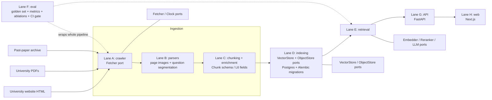

# Architecture

## System map and data flow



Retrieval pipeline (Lane E), in order:

```
router → hybrid search → rerank → abstain → answer
```

- **router** classifies language (English / Urdu / Roman Urdu) and intent.
- **hybrid search** combines lexical and vector recall over the indexed chunks.
- **rerank** reorders candidates using the Reranker port.
- **abstain** applies the evidence threshold; weak evidence stops here (L13).
- **answer** generates a cited response via the LLM port, with image refs
  (e.g. past-paper pages) resolved through the ObjectStore port.

Every answer carries provenance (`source_url`, `last_crawled`, L5).

## Module boundaries

```
core ← packages ← apps
```

- `packages/core/src/uni_rag_core/` — ports (`Protocol`s), schemas, settings,
  exceptions and deterministic fakes. Depends on nothing internal.
- `packages/` — ingestion (`crawler`, `parsers`, `chunking`, `enrichment`),
  `indexing`, `retrieval`, `eval`. Depend on core only.
- `apps/` — `api` (FastAPI) and `web` (Next.js). Depend on packages (and core
  transitively). Apps never depend on other apps.
- Dependency rule (L2): dependencies point leftward. Core never imports a
  package or app; packages never import apps; domain code never imports
  infrastructure. Enforced by import-linter in CI.

## Foundation stage

At foundation stage **only interfaces and fakes exist**. Lane 0 ships the port
protocols, the `Chunk` schema, typed settings, the exception hierarchy and one
deterministic in-memory fake per port — plus their contract tests. No real
crawling, parsing, embedding, reranking, LLM calls, vector stores or model
weights are wired in yet. Lanes A–H build adapters against these frozen
contracts. Real external logic is explicitly parked (see `docs/PARKING_LOT.md`).
